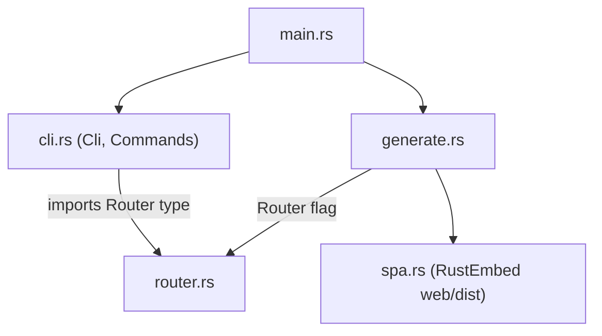

# CLI

Module layout of the Rust CLI, a standalone Cargo crate in `cli/` (no workspace — the repo root has no cargo files; run cargo from `cli/` or with `--manifest-path cli/Cargo.toml`). Split from a single 184-line `main.rs` into five focused modules (locked 2026-10-16); behavior-preserving move refactor. See [summary.md](summary.md) for the locked CLI decisions (Rust, shells out to `structurizr`).

## Modules

- `main.rs` — entry point only: parses `Cli`, dispatches `Commands::Generate` to `generate::generate`.
- `cli.rs` — clap definitions (`Cli`, `Commands`) with the flag docs; the only clap-facing module.
- `router.rs` — the router-mode domain concept ([terminology](../terminology.md)): `Router` enum (carries the `ValueEnum` derive), `SiteConfig` (the `window.site` payload), `normalize_base_path` (hash mode rejects `--base-path`; path mode requires a leading `/`, forbids `<`, trims to a trailing slash), `rewrite_for_path_router` (rebases `./assets/` onto the base path, injects the `window.site` script before `</head>`).
- `spa.rs` — the embedded bundle: `Spa` (`RustEmbed` over `../web/dist`, relative to the crate root), `write_assets` (writes all non-index assets, returns the `index.html` content), `write_asset` helper (reused for `index.html`/`404.html`).
- `generate.rs` — split into `generate` (thin orchestrator: normalize → export → assemble → println), `export_workspace` (workspace validation + the `structurizr export` shell-out; returns the exported `<stem>.json` path) and `assemble_site` (rename to `workspace.json`, `spa::write_assets`, writes `index.html` (+ `404.html` in path mode) per router mode). `cli/tests/cli.rs` exercises the binary end-to-end against a shell-script `structurizr` shim on the child's PATH (unix only).

Dependency direction: `cli.rs` imports the `Router` type from `router.rs`, not the reverse — `router.rs` is self-contained domain logic with no clap-facing obligation beyond the derive.

## Invariants

- `normalize_base_path` and `rewrite_for_path_router` are pure functions.
- Tests (all in-module `#[cfg(test)]` except `cli/tests/cli.rs`): router edge cases incl. error messages, spa asset writing, generate rename + hash/path output, clap parsing via `try_parse_from`. The integration test replaces the `structurizr` binary with a shim script that mimics the export contract (`<out>/<stem>.json`), so tests never need Java; swap in the real CLI only for manual smoke checks.
- The structurizr shell-out lives in `export_workspace` in `generate.rs`; extract it when branch support grows it (branch support is the next CLI-side parity item, [plans/rewrite.md](../plans/rewrite.md)).
