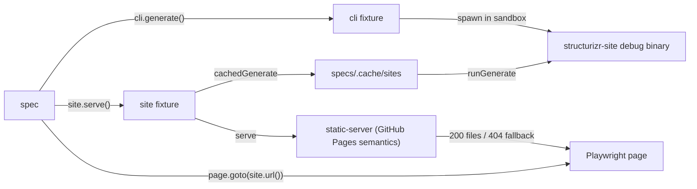

# Executable Specs

The ESDD (Executable Spec Driven Development) layer: TypeScript specs in `specs/` that are both a
specification of end-user-visible behaviour and the test verifying it. Specs are authored and
maintained by the human; agents implement until the specs pass and may propose spec changes but
never edit specs unilaterally (charter: [specs/README.md](../../../specs/README.md)).

## Layout

- `specs/cli/*.spec.mts` — CLI specs, driven through the `cli` fixture (plain Node APIs, no browser).
- `specs/web/*.spec.mts` — generated-site specs, driven through the `site` fixture + Playwright `page`.
  Specs are the only thing in `specs/` (`testMatch` is `**/*.spec.mts`, so new spec directories need
  no config change); shared DSL workspaces live in `specs/workspaces/` (spec input), with the loader
  in `specs-verifier/workspaces/`.
- `specs-verifier/fixtures/` — the glue (agent-maintainable). Fixtures drive and observe; assertions live in specs.
- Runner: Playwright Test for both spec kinds (CLI specs never launch a browser). The verifier's pnpm
  package (scripts, deps, `playwright.config.ts`, `node_modules`, caches) lives in `specs-verifier/` at
  the repo root. Two tooling files sit outside it: the repo-root `tsconfig.json` (TypeScript resolves a
  tsconfig by walking up from each file, and `specs/` must contain only specs — it defines the `@/`
  aliases and covers `specs/**/*.mts` + `specs-verifier/**/*.ts`) and nothing else. Spec files are
  `.spec.mts`: with no `package.json` above `specs/`, the `.mts` extension is the ESM declaration for
  Node and Playwright (a plain `.ts` spec outside a `"type": "module"` scope is compiled as CJS, which
  breaks the fixtures' `import.meta` usage). Playwright 1.64 only applies tsconfig `paths` to files it
  classifies as TypeScript (`.ts`/`.tsx`), so the root tsconfig sets `allowJs` to make paths apply to
  `.mts` spec files.

## Fixtures

- `sandbox` — per-test `mkdtemp` directory, disposed after the test. Everything a spec writes lives there.
- `cli` — spawns `cli/target/debug/structurizr-site` (override: `STRUCTURIZR_SITE_BIN`) in the sandbox
  via `child_process`; returns `CliResult` (`ok`, `exitCode`, `stdout`, `stderr`, `file()`, `json()`,
  `exists()`). `generate({workspace, router, basePath, output, structurizr})` — omitted options keep
  the CLI's own defaults, so specs exercise them. `structurizr` injects a POSIX shim on the child's
  PATH (unix only; same technique as `cli/tests/cli.rs`) for export-failure specs.
- `site` — `serve(workspace, {router, basePath})`: generates via the real CLI (through the site
  cache) and serves the output directory from a hand-rolled Node static server (no dependencies)
  that mirrors the hosting semantics a generated site faces: files served directly, path-mode
  `404.html` fallback served with 404 status (GitHub Pages semantics), optional base-path mount.
  `url(path)` builds absolute URLs; `#` fragments pass through for hash routing.
- `site-cache` — persistent site cache under `specs/.cache/sites/`, keyed by sha256 of workspace
  content + generate arguments + web/dist fingerprint (per-file mtime and size) + binary
  fingerprint. Concurrent generations stage into a temp dir and atomically rename; first rename
  wins. It caches whole sites because `generate` always shells out to `structurizr` (a JVM boot per
  run, even for JSON input) — caching only the export would not remove the JVM cost from web specs.
- `matchers` — `expect(run).toSucceed()` (extended Playwright expect; the failure message includes
  the run's stdout/stderr).

## Invariants

- Specs assert; fixtures only drive and observe. No expectations in `support/fixtures/`.
- Web specs always test the real generated artifact: CLI output served statically — never the Vite
  dev server.
- The static server mirrors the hosting story documented in README (hash = plain static; path =
  404.html fallback + base-path mount). If the hosting story changes, the server changes with it.
- Debug binary + fresh `web/dist`: the cache key includes the dist fingerprint, so web specs always
  test the current `web/` source after a build.
- `pnpm --dir specs-verifier test` builds the SPA and CLI before running; `pnpm --dir specs-verifier check` typechecks.
- Directory entry modules (`fixtures/index.ts`, `workspaces/index.ts`) are imported via tsconfig
  path aliases (`@/fixtures`, `@/workspaces`) — never as bare directory paths, which Playwright's
  ESM loader cannot resolve. All other relative imports use explicit `.ts` extensions for the same
  reason.
- CI (`.github/workflows/ci.yml`) installs Java + the structurizr CLI (classpath invocation over the
  release zip's `lib/*` — not a fat jar; Homebrew repackages it as a WAR), installs chromium, and
  runs the specs after the Rust steps.
