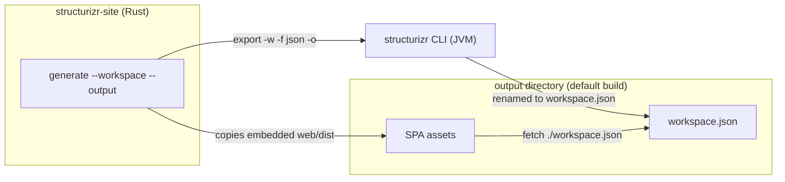

# Architecture

Current state of the new system. Status: **walking skeleton works** (workspace and software-system pages with client-side routing; no diagram rendering yet).

## Decisions

1. **SPA, not static HTML generation.** The UI is a single-page application; there is no per-page static HTML pipeline.
2. **The SPA reads Structurizr workspace JSON from the web server.** Fetched at runtime as `./workspace.json`, relative to `index.html`.
3. **The CLI is written in Rust.** Binary and crate name: `structurizr-site`. Module layout: [cli.md](cli.md).
4. **The CLI shells out to the `structurizr` CLI** for workspace processing and JSON export (resolved fork #1). It accepts DSL or JSON input. Consequence: users need Java at build time.
5. **The SPA is Vite + React + TypeScript** in `web/` (resolved fork #4). Assets are embedded into the binary with `rust-embed` (`#[folder = "web/dist"]`): release builds embed at compile time, debug builds read `web/dist` from disk at runtime.
6. **Routing is client-side via react-router (v8), with two generate-time URL modes.** `--router hash` (default) mounts `HashRouter` and works on any static host from any mount point; `--router path` mounts `BrowserRouter` with the `--base-path` basename and requires SPA-fallback hosting. For path mode the CLI rewrites the SPA bundle's relative asset URLs (`./assets/…` → `{base-path}assets/…` — relative URLs would resolve against nested route paths) and injects `` before `</head>`; the SPA reads that global (module scripts run after document parsing, so an inline head script always wins) and defaults to hash mode when absent. Path mode also writes `404.html` (a copy of the rewritten index.html) because GitHub Pages serves the site's 404.html at missing paths with the URL preserved — that is the SPA-fallback mechanism for project sites. Route set: `/` (workspace home), `/software-systems/:id`, `*` (not found).

Still open: diagram layout (#2), serving model (#3), parity order (#5) — [open-questions.md](open-questions.md).

## Shape

- Output layout: `index.html`, `assets/` (hashed SPA bundles), `workspace.json`; path mode adds `404.html` and rewrites `index.html`. Vite `base: './'` keeps asset URLs relative, so hash-mode output works from any static path; path mode trades that away for clean URLs and rebases asset URLs onto `--base-path`.
- `generate` does not clean the output directory; repeated runs can leave stale hashed assets.

## Invariants

- The UI is a SPA; no static HTML generation returns.
- The SPA's data source is Structurizr workspace JSON fetched from the web server — not embedded or generated content. Runtime fetches stay relative (`./workspace.json`) in hash mode and derive from the injected base path in path mode.
- The CLI is Rust; workspace processing happens in the `structurizr` CLI (no DSL parsing in Rust).
- Release binaries are self-contained; debug builds require `web/dist` to exist, so build the SPA before the first `cargo build`.
