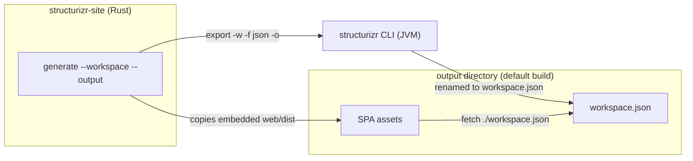

# Architecture

Current state of the new system. Status: **walking skeleton works** (shows workspace name only; no diagram rendering yet).

## Decisions

1. **SPA, not static HTML generation.** The UI is a single-page application; there is no per-page static HTML pipeline.
2. **The SPA reads Structurizr workspace JSON from the web server.** Fetched at runtime as `./workspace.json`, relative to `index.html`.
3. **The CLI is written in Rust.** Binary and crate name: `structurizr-site`.
4. **The CLI shells out to the `structurizr` CLI** for workspace processing and JSON export (resolved fork #1). It accepts DSL or JSON input. Consequence: users need Java at build time.
5. **The SPA is Vite + React + TypeScript** in `web/` (resolved fork #4). Assets are embedded into the binary with `rust-embed` (`#[folder = "web/dist"]`): release builds embed at compile time, debug builds read `web/dist` from disk at runtime.

Still open: diagram layout (#2), serving model (#3), parity order (#5) — [open-questions.md](open-questions.md).

## Shape

- Output layout: `index.html`, `assets/` (hashed SPA bundles), `workspace.json`. Vite `base: './'` keeps asset URLs relative, so the output works from any static path.
- `generate` does not clean the output directory; repeated runs can leave stale hashed assets.

## Invariants

- The UI is a SPA; no static HTML generation returns.
- The SPA's data source is Structurizr workspace JSON fetched from the web server — not embedded or generated content.
- The CLI is Rust; workspace processing happens in the `structurizr` CLI (no DSL parsing in Rust).
- Release binaries are self-contained; debug builds require `web/dist` to exist, so build the SPA before the first `cargo build`.
