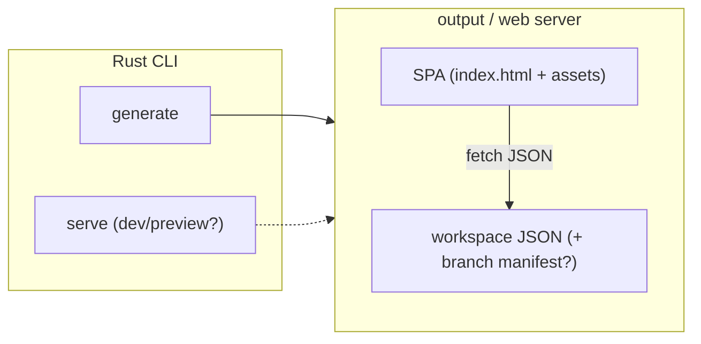

# Architecture

Current state of the new system's architecture. Status: **design phase — no code exists yet.**

## Locked decisions

1. **SPA, not static HTML generation.** The UI is a single-page application; there is no per-page static HTML pipeline.
2. **The SPA reads Structurizr workspace JSON from the web server.** The workspace content the SPA renders is fetched over HTTP as JSON.
3. **The CLI is written in Rust.**

Nothing else is decided. Open forks: [open-questions.md](open-questions.md).

## Tentative shape (discussion sketch — NOT decided)

- The CLI produces something a web server can host; the SPA fetches workspace JSON at runtime and renders client-side.
- Component names, responsibilities, and boundaries are deliberately vague until the open forks resolve.

## Invariants

- The UI is a SPA; no static HTML generation returns.
- The SPA's data source is Structurizr workspace JSON fetched from the web server — not embedded or generated content.
- The CLI is Rust.
