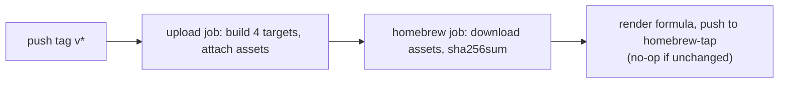

# Distribution

How the tool reaches users. Status: **live** (GitHub Release binaries + Homebrew tap since v0.0.1-pre-alpha1).

## Channels

1. **GitHub Release assets** — produced by [.github/workflows/release.yml](../../.github/workflows/release.yml) on `v*` tags via [taiki-e/upload-rust-binary-action](https://github.com/taiki-e/upload-rust-binary-action). Asset naming has **no version in the filename**:

   ```
   structurizr-site-<target>.tar.gz   (unix)
   structurizr-site-<target>.zip      (windows)
   ```

   Targets: `aarch64-apple-darwin` (runner macos-26), `x86_64-apple-darwin` (cross-compiled on the same arm64 runner — Apple's toolchain supports both archs), `x86_64-unknown-linux-musl` (static), `x86_64-pc-windows-msvc`. Tarballs contain the bare binary at the archive root (no leading directory).

2. **Homebrew tap** — [dirkgroot/homebrew-tap](https://github.com/dirkgroot/homebrew-tap), install with `brew install dirkgroot/tap/structurizr-site`. Install path: `brew tap dirkgroot/tap` auto-resolves the repo name `homebrew-tap`; users never need an explicit URL.

## The formula

- **Binary-only**: installs the prebuilt release binary (`bin.install "structurizr-site"`); never builds from source. Rationale: the SPA is embedded with `rust-embed` from `web/dist`, so a source build would need node + pnpm under brew — not viable. Matches the invariant that release binaries are self-contained.
- One `url` + `sha256` per platform via `on_macos`/`on_linux` + CPU-arch conditionals. The URL only varies by **tag** (`releases/download/v#{version}/…`), not filename, because of the naming scheme above.
- `depends_on "structurizr"` (homebrew-core): the generated binary shells out to the `structurizr` executable at runtime, so it's a hard runtime dependency. Not the deprecated `structurizr-cli` — that repo is archived and its executable is named `structurizr-cli`, which the shell-out would never find.
- `test` runs `--version`; `livecheck` uses `strategy :github_latest`.
- Windows has no formula (no brew on Windows); the zip serves direct downloads.

## Automation

The release workflow's `homebrew` job (needs `upload` only) regenerates the **entire formula from a heredoc** each release — no template patching, so the tap repo is a pure publish target and hand-edits to the formula get overwritten (intentionally). Flow:



Release notes are regenerated by the `release-notes` job with `git cliff --latest --strip header` — CHANGELOG.md is never read in CI, so hand-curated changelog wording never reaches the published notes. `cliff.toml` skips `chore(release)` commits (they would otherwise land in "Changed" via the catch-all parser) and hardcodes the repo URL in the footer because `remote.github.owner`/`remote.github.repo` resolve empty in CI checkouts.

Prerequisite: the `HOMEBREW_TAP_TOKEN` secret — a fine-grained PAT with `contents:write` on `dirkgroot/homebrew-tap` only. `GITHUB_TOKEN` cannot push cross-repo.

## Releasing (operational)

See README "Releasing" for the full procedure. The formula carries all three platform blocks (macOS arm64, macOS Intel, Linux) since v0.0.1-pre-alpha2; install via the tap is verified working.

## Invariants

- Release binaries are self-contained; the formula must never require a source build.
- The workflow-generated formula is the source of truth; the tap is write-only from releases.
- Asset filenames never contain a version; the version lives only in the tag path segment.

Related: [architecture/summary.md](architecture/summary.md) (rust-embed invariant) · [background/original-tool.md](background/original-tool.md) (how the original tool distributes: fat jar + Docker)
